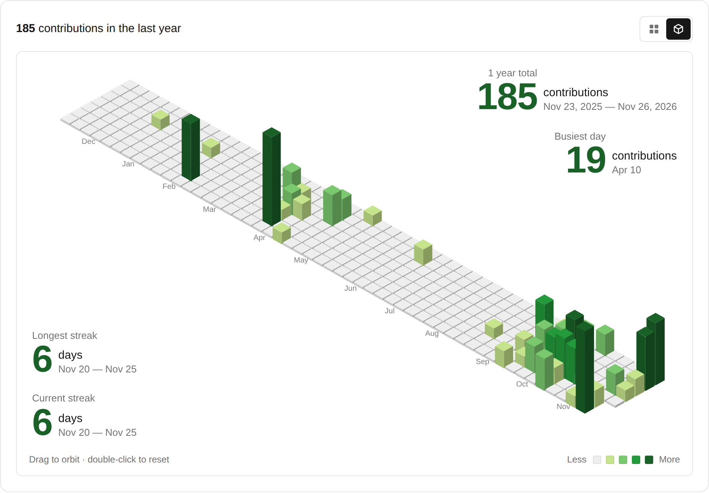

<h1 align="center">Hi, I'm Yashvee 👋</h1>

  <b>Robotics &amp; Automation Engineering Student</b> 
  ROS2 · 3D SLAM · Sensor Fusion · Autonomous Navigation · Embedded Systems

  
  

---

## 💫 About Me

I'm a robotics and automation student who works across robotic simulation, real-world hardware integration and autonomous systems. I develop robotic applications, integrate sensors and actuators, implement motion control, and explore perception and learning-based approaches for robotics.

My work ranges from designing and simulating robotic systems to deploying and testing them on physical hardware: robotic arm development, robot simulation, ROS2-based applications, embedded motor control and autonomous mobile robots.

I'm especially interested in **3D SLAM, sensor fusion, navigation, computer vision and machine learning**, and in applying them to robotic perception and decision-making. I enjoy working where mechanical systems, electronics and software meet, and seeing how individual components come together into a working robot.

Powered by coffee, driven by curiosity, and occasionally fixing bugs that I accidentally created myself. 💻😅

---

## 🎯 Current Focus

- 🗺️ 3D SLAM and sensor fusion for autonomous navigation
- 📡 Working with LiDAR and depth cameras for robot perception
- 🤖 Robotic arm modelling, simulation and motion planning (URDF, MoveIt)
- 🔌 Embedded motor control and CAN communication on ESP32
- 🧠 Applying machine learning and computer vision to robotics

---

## 🛠️ Technical Areas

| Area | Skills |
|---|---|
| 🤖 **Robotics** | Robotic Arms, Manipulation, Motion Planning, Robot Integration |
| 🖥️ **Simulation** | Robot Modeling, URDF, Gazebo, RViz, Simulation & Testing |
| ⚙️ **Middleware** | ROS2, MoveIt, TF2, Navigation |
| 📡 **Autonomous Systems** | 3D SLAM, Sensor Fusion, LiDAR, Depth Cameras |
| 👁️ **AI & Perception** | Machine Learning, Computer Vision, Object Detection |
| 🔌 **Embedded Systems** | ESP32, Microcontrollers, Motor Drivers, CAN Communication |
| 💻 **Programming** | C++, Python |

---

## 🧰 Tools & Technologies

  
  
  
  
  
  
  

---

## 🚀 Featured Projects

| Project | What it is |
|---|---|
| [**web-rviz2**](https://github.com/Yashvee30/web-rviz2) | Web-based RViz (Python) |
| [**esp32_microros**](https://github.com/Yashvee30/esp32_microros) | micro-ROS on ESP32 |
| [**nuttx_nucleo-h7**](https://github.com/Yashvee30/nuttx_nucleo-h7) | NuttX RTOS on a custom flight controller (C) |
| [**person_follow**](https://github.com/Yashvee30/person_follow) | Person detection and following (Python) |
| [**Jetbot**](https://github.com/Yashvee30/Jetbot) | Jetbot robot project (Python) |
| [**SANKEETAK: sign language converter**](https://github.com/Yashvee30/SANKEETAK---sign-language-converter) | SIH hackathon project (Python) |

---

## 🏙️ My Contribution Skyline

*Updated daily. Click the image to open the live, interactive version.*

---

## 🤝 Let's Connect

I'm always open to discussing robotics, SLAM and navigation, embedded systems, or collaborating on projects.

Thanks for stopping by, feel free to explore my repositories. ⭐
